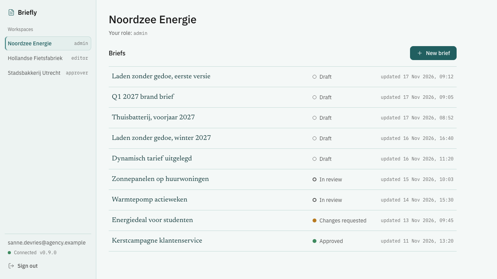
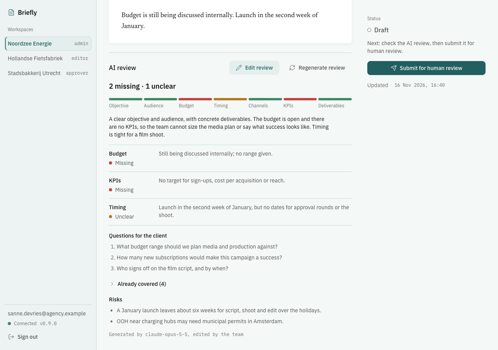
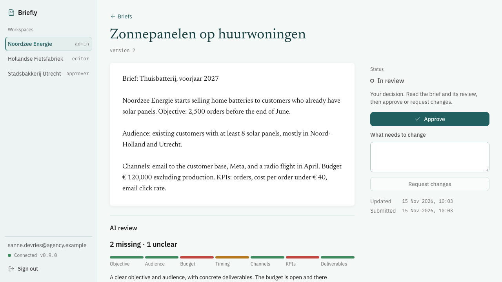
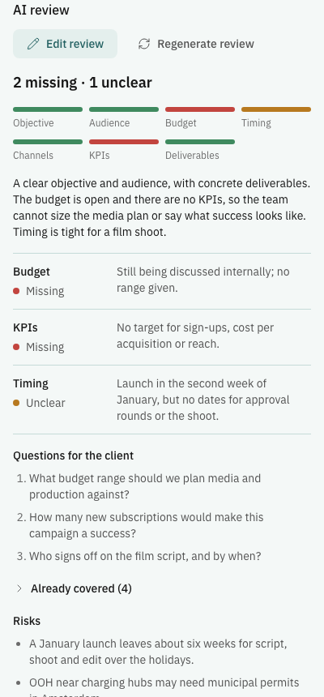
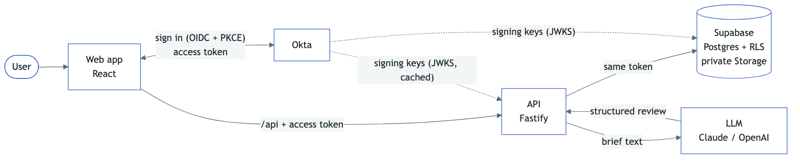
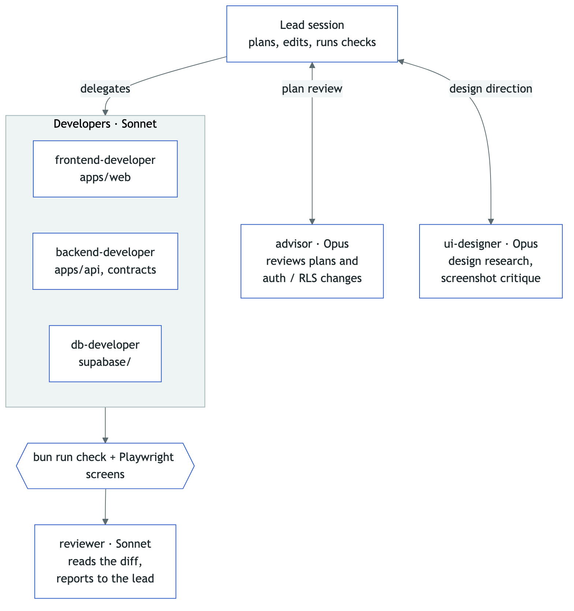

# Briefly

Briefly checks client campaign briefs before work starts. Paste a brief or upload a PDF or Word file, and an AI review marks which essentials are present, unclear or missing (objective, audience, budget, timing, channels, KPIs, deliverables), lists the questions to send back to the client and flags risks. The team edits the review, then submits the brief for a human approver to approve or send back.



## How it works

- **Workspaces.** Each client is a workspace. Members are editors, approvers or admins; you only see workspaces you belong to.
- **Briefs.** Editors write or upload briefs. Uploaded files stay private; their text is extracted on the server.
- **AI review.** Generated on demand, editable, and marked outdated when the brief changes after it was made.
- **Approval.** Draft → in review → approved or changes requested. Nobody approves their own brief.







## Stack

| | |
|---|---|
| Web | React, Vite, TanStack Query, Tailwind (`apps/web`) |
| API | Fastify on Node 22 (`apps/api`) |
| Contracts | Zod schemas shared by web and API (`libs/contracts`) |
| Data | Supabase Postgres with row-level security, private Storage (`supabase/`) |
| Auth | Okta (OIDC) |
| AI | Claude or OpenAI, structured output validated with Zod |
| Tooling | Nx, Bun, Vitest, Playwright, pgTAP |

## Architecture



## Design notes

- **One identity, end to end.** The API verifies the Okta access token, then forwards that same token to Supabase. Postgres row-level security decides what each user can read or change, so a bug in a route can't leak another client's data.
- **The browser only talks to the API.** No database client in the web app, and every response is parsed against the shared contract.
- **Tenancy in the URL.** Routes are `/api/workspaces/:wsId/...`; an unknown and a forbidden workspace both return 404. Every tenant table has a cross-tenant RLS test.
- **Workflow rules live in the database.** A trigger enforces status changes and blocks self-approval; the API and UI mirror it for display.
- **AI stays on the server.** Brief text is treated as untrusted input and never logged. The model sits behind one `ReviewGenerator` port, with a fake for tests and offline demos.

## How it was built

Briefly is built with Claude Code. A lead session plans and edits; scoped subagents (in `.claude/agents`) each own one part of the stack, and read-only agents review. A hook runs `bun run check` before any turn can finish.



## Running locally

Needs Bun 1.3, Node 22, an Okta app and a Supabase project (or `bunx supabase start` for a local one).

```sh
bun install
cp .env.example .env   # fill in Okta, Supabase and an AI key, or REVIEW_GENERATOR=fake
bun run dev:api        # http://127.0.0.1:3000
bun run dev:web        # http://localhost:5173, proxies /api
```

The API also runs in a container: `docker compose up --build api`, then `curl localhost:3000/api/health`.

## Checks

```sh
bun run check          # file sizes, RLS coverage, then lint, typecheck, test and build for every project
bunx supabase test db  # pgTAP: RLS and workflow tests against a local database
bun run visual         # Playwright: every screen at 400px and 1280px, with axe and overflow checks
```

The Playwright run needs no Okta or API: sessions are seeded and `/api` is mocked in the browser. The screenshots above come from `README_SHOTS=1 bunx playwright test e2e/readme.spec.ts` in `apps/web`; the diagrams are rendered from `docs/diagrams/*.mmd`:

```sh
for f in docs/diagrams/*.mmd; do npx -y @mermaid-js/mermaid-cli@11.4.2 -i "$f" -o "${f%.mmd}.png" -s 2 -b white; done
```
